# 🧬 **Breeding** & Reprodução


Breeding é o acasalamento entre Pokémon. No Sitrus ele é usado principalmente para **Shiny Hunt** e para criar Pokémon perfeitos (**5/6 IVs 31**).


## O que é preciso para realizar o Breed?

-   Um Pokémon **macho** e uma **fêmea**, ou um **Ditto** (substitui qualquer gênero e breeda com qualquer Pokémon).
-   Pokémon **sem gênero** breedam apenas com Ditto.
-   O item **Bloco de Pasto** / **Pasture Block** (o nome muda conforme o idioma do jogo).
-   Cada jogador pode ter até **5 Blocos de Pasto** ao mesmo tempo.

<figure>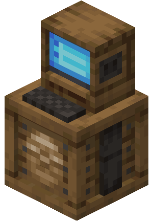<figcaption>Bloco de Pasto</figcaption></figure>

## Como realizar o Breeding?

1.  Coloque o Bloco de Pasto num lugar apropriado.
2.  Clique com o **botão direito** no bloco.
3.  Na tela **Daycare Setup**, clique com o **botão esquerdo** no ícone do ovo.

<figure>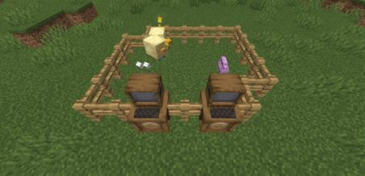<figcaption>Pasture Block colocado no mundo</figcaption></figure>

<figure>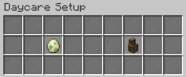<figcaption>Tela Daycare Setup</figcaption></figure>

Depois de clicar, você sai automaticamente do pasto. Clique de novo com o botão direito para abrir a tela de Daycare:

<figure>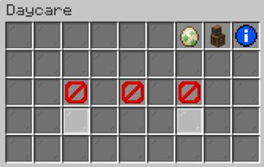<figcaption>Tela Daycare com espaços vazios</figcaption></figure>

Nessa tela há dois ícones no canto: o ovo e o **Bloco de Pasto**. Clique no ícone do bloco para abrir o PC e escolher os 2 Pokémon.

<figure>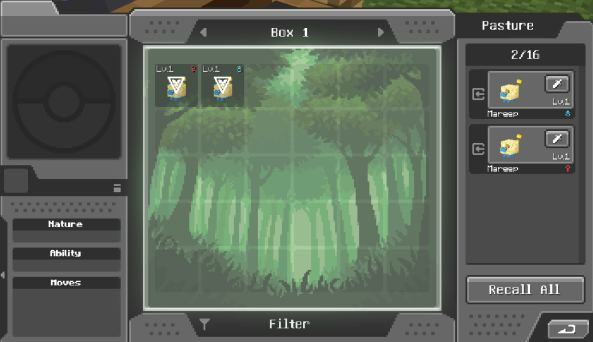<figcaption>PC do Pasture para selecionar Pokémon</figcaption></figure>

<figure>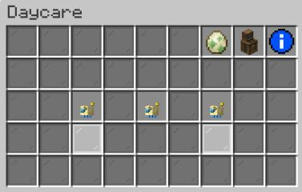<figcaption>Daycare com Pokémon selecionados</figcaption></figure>

## Você falou incubadora?

A **incubadora** armazena os ovos e choca eles. Antes dela, era preciso deixar o ovo no inventário e andar/correr com ele na mão. Com a incubadora isso não é mais necessário.

<figure>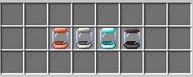<figcaption>Incubadoras de cobre, ferro, diamante e netherita</figcaption></figure>

Elas são feitas com minérios do Minecraft: **cobre**, **ferro**, **diamante** e **netherita**.


⚠️ A incubadora de **ouro** **não está disponível** no servidor Sitrus.


### Informações das incubadoras

| Incubadora | Capacidade | Choca simultaneamente |
| --- | --- | --- |
| **Cobre** | 16 ovos | 2 ovos |
| **Ferro** | 32 ovos | 4 ovos |
| **Diamante** | 48 ovos | 6 ovos |
| **Netherita** | 64 ovos | 8 ovos |

### Craft atualizado das incubadoras

<figure>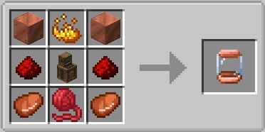<figcaption>Craft da incubadora de cobre</figcaption></figure>

<figure>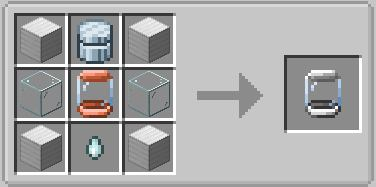<figcaption>Craft da incubadora de ferro</figcaption></figure>

<figure>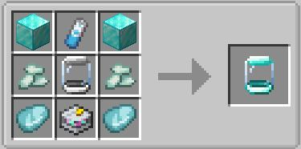<figcaption>Craft da incubadora de diamante</figcaption></figure>

<figure>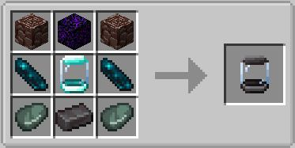<figcaption>Craft da incubadora de netherita</figcaption></figure>

## O breeding em si

### 🧬 Habilidade Oculta (HA)

-   Ovos **nunca** nascem com HA por conta própria. O filhote só nasce com HA se herdar de um dos pais que já tenha a habilidade.
-   **Só a fêmea** transmite a HA para o ovo. Se o Pokémon com HA for macho, ele não passa a habilidade diretamente. Nesse caso, breede ele com um **Ditto** até nascerem fêmeas com HA, e use essas fêmeas no breeding final.
-   Ditto com a habilidade **Impostor** é exceção: mesmo com HA, essa habilidade não é transferida nem perdida.


⚠️ **Atenção:** ao usar um Pokémon com HA para breedar (macho ou fêmea), ele **perde a habilidade** depois do cruzamento. Você “gasta” a HA transferindo-a para o filhote.


### 🥚 Tempo de choco

Cada espécie tem um tempo de choco diferente. Alguns ovos demoram bem mais. Se um ovo parecer “travado”, pode ser normal para aquela espécie.

### ✨ Shiny em ovos

Sim, é possível chocar um Pokémon shiny. Não dá para saber antes: você só descobre no momento em que o ovo choca. Não existe indicador prévio.

### 🌾 Cuidados com os Pasture Blocks

-   Escolha bem o local. Se o pasto causar dano (lava, quedas, mobs), os Pokémon deixados lá podem morrer.
-   Cada Pasture Block comporta no máximo **16 ovos** ao mesmo tempo. Ao atingir o limite, use outro bloco ou recolha os ovos para continuar.

## Booster Dizigótico

**Eita! O que é isso?**

O booster Dizigótico **duplica a quantidade de ovos por 5 gerações**: **10 ovos pela metade do tempo**.

<figure>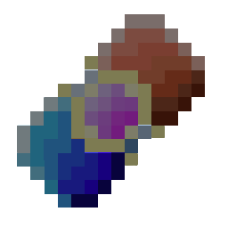<figcaption>Booster Dizigótico</figcaption></figure>

Ele pode ser comprado nas lojas de **Itens de Breed** em cada PokéMart das cidades do servidor.

<figure><figcaption>Loja Itens de Breed no PokéMart</figcaption></figure>


## Modo de usar

Com o item na mão, clique com o **botão direito** no Pasture Block que você quer turbinar. Simples, rápido e prático.

