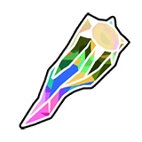
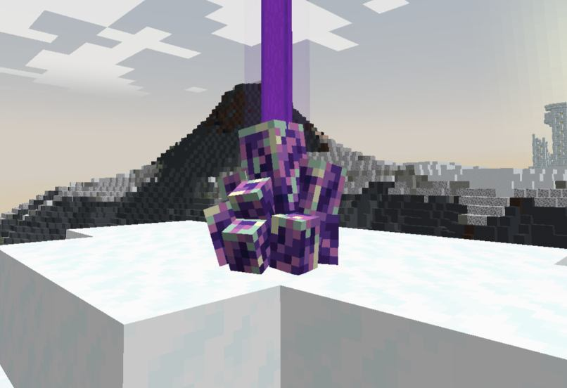
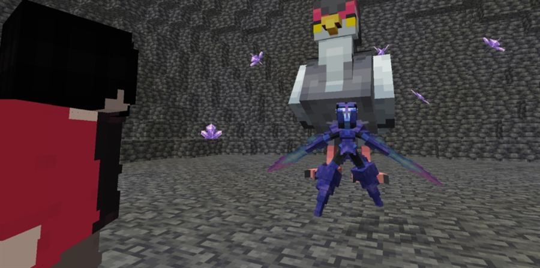
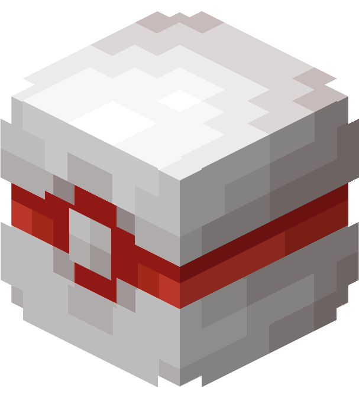

# ⚔️ **Raids**

Na Região de Sintra existem dois desafios de Raid: as **Raids de Cristais**, batalhas solo nas estruturas espalhadas pelo mapa, e a **Raid Global**, disputada na Arena Celestial contra outros treinadores.

## ⚔️ Raids de Cristais


As Raids de Cristais são batalhas especiais contra Pokémon poderosos que aparecem dentro das Raids, estruturas brilhantes espalhadas pela **Região de Sintra**.


<figure><figcaption>Cristal de Raid</figcaption></figure>

## 🔍 Encontrando uma Raid

As Raids surgem naturalmente pela Região de Sintra.

Quando estão ativas, emitem um **feixe de luz colorido** (de acordo com a tipagem da Raid), indicando que há um Pokémon de Raid pronto para ser desafiado.

<figure><figcaption>Estrutura de Raid ativa com feixe de luz</figcaption></figure>

## 🧠 Iniciando a Raid

Ao interagir com uma Raid ativa, você é teletransportado para a arena do Pokémon e deve batalhar contra ele. As Raids de Cristais são **solos**: você sozinho contra o Pokémon da Raid.

## 💥 Durante a batalha

Você e seus Pokémon enfrentam um Pokémon de Raid com **status elevados** e habilidades especiais, o que deixa o desafio bem mais intenso.

<figure><figcaption>Batalha contra o Pokémon da Raid</figcaption></figure>

## 🎁 Recompensas

Ao participar das Raids, você pode receber itens valiosos. Eles servem para melhorar seus Pokémon, aumentar atributos ou gerar lucro na venda.

**Lista de itens possíveis:**

-   Poções
-   Mochis
-   Vitaminas
-   Doces de Experiência
-   Penas de EV
-   Upgrade
-   Gemas de Tipagem
-   Itens de Segurar
-   TR Blank
-   Dubious Disc
-   Barra de Netherite
-   Doces de IV
-   Poké Balls
-   Mega Pedras
-   Ability Patch

## ⏳ Renovação das Raids

Depois da batalha, a Raid entra em recarga e volta a ficar ativa após um certo tempo.


## ⚠️ Atenção

As Raids costumam ser desafiadoras, principalmente para iniciantes. Enfrente-as só quando estiver bem preparado.


## ⚔️ Raid Global

A Raid Global consiste em batalhas importantes contra Pokémon poderosos que aparecem na **Arena Celestial**, erguida sob o olhar silencioso do Trio da Criação, entre as montanhas geladas da Região de Sintra.

Nesse desafio, vocês competem contra outros jogadores para descobrir quem é o mais forte na Arena. Apenas os treinadores mais poderosos serão recompensados.

A Raid Global é dividida em duas categorias: **Raid Comum** e **Raid Fragmentada**.

<figure><figcaption>Bloco da Arena Celestial</figcaption></figure>

**Recompensas:**

| Colocação | Moedas |
| --- | --- |
| 🥇 Top 1 | 100 Moedas |
| 🥈 Top 2 | 80 Moedas |
| 🥉 Top 3 | 60 Moedas |
| 🎖️ Participante | 30 Moedas |

### Raid Global Comum

As Raids Comuns surgem naturalmente a cada **2 horas** na Arena Celestial. Por dia, os jogadores têm **5 tentativas** para sair vitoriosos.

**Horários:**

-   🕙 08h
-   🕙 12h
-   🕙 14h
-   🕙 18h
-   🕙 20h

**Quais Pokémon iremos enfrentar?**

Na Raid Comum aparecem todos os Pokémon básicos em suas últimas formas (com exceção de Lendários, Ultra Beasts e Paradoxos).

### Raid Global Fragmentada

As Raids Fragmentadas aparecem em horários específicos na Arena Celestial. Os jogadores podem enfrentá-las **3 vezes por dia**.

**Horários:**

-   🕙 10h
-   🕓 16h
-   🕙 22h

**Quais Pokémon iremos enfrentar?**

Na Raid Fragmentada vocês enfrentam Lendários, Ultra Beasts, Paradoxos, Iniciais e Pseudo-lendários.
